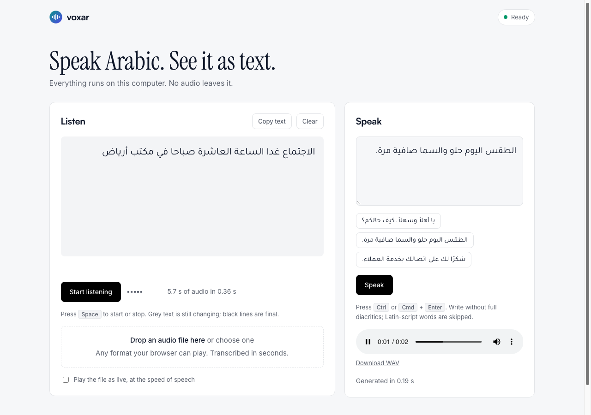
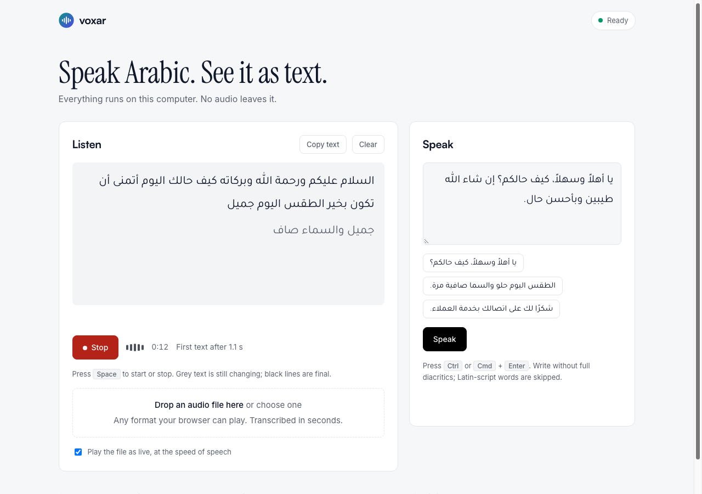
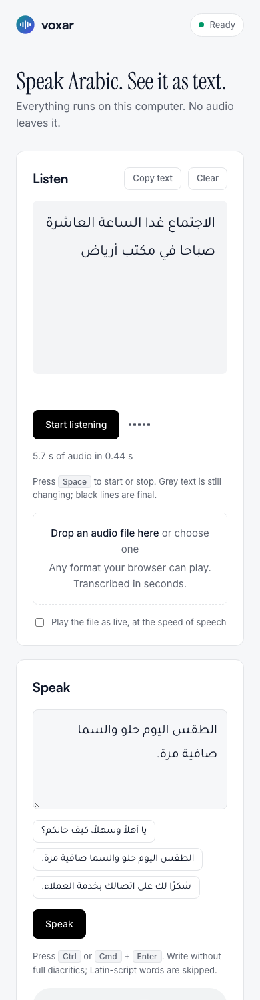
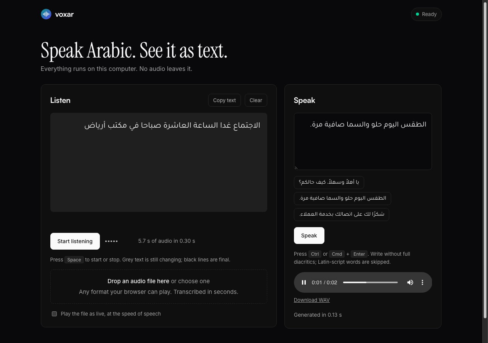

<p align="center">
  <picture>
    <source media="(prefers-color-scheme: dark)" srcset="assets/logo-dark.svg">
    
  </picture>
</p>

<p align="center">
  <b>Dialect-aware speech that runs on your own device.</b><br>
  Streaming speech-to-text and Saudi-dialect text-to-speech: no cloud, no telemetry, one command.
</p>

<div align="center">
<details><summary><b>Read this in other languages</b></summary>

🇺🇸 <a href="README.md">English</a> | 🇸🇦 <a href="docs/translations/README.ar-SA.md">العربية</a>

</details>
</div>

<p align="center">
  <a href="LICENSE"></a>
  
  
</p>

> **Pre-alpha.** Speed, memory and server load were measured on one machine: see [Performance](#performance-measured-on-one-machine).

Run `voxar transcribe` on an audio file and Arabic speech becomes text on your own machine. Run `voxar say` and Saudi-dialect text becomes speech. Point an AI agent at `voxar mcp` and it can do both.

- **On-device and private.** Models run locally. No audio is sent anywhere, and there is no telemetry. The only network use is the explicit `voxar models pull` download.
- **Every model is verified.** Downloads are HTTPS-only, and every file is checked against a pinned SHA-256 before it is used. A bad or interrupted download never looks installed.
- **Small and dependency-free core.** The Apache-2.0 core has no runtime dependencies. Engines, the MCP server and the HTTP server are optional extras, and text-to-speech is a separate GPL-3.0 plugin on purpose (see [Licensing](#licensing)).

**Get started** (about a minute, plus a ~31 MB model download). You need [Python 3.10+](https://www.python.org/downloads/) and [uv](https://docs.astral.sh/uv/):

```bash
git clone https://github.com/HasanBGit/Voxar.git
cd Voxar
make setup     # install
make models    # download the speech-to-text model
make run       # then open http://127.0.0.1:8765
```

No `make` (for example on Windows)? Run the commands inside the [`Makefile`](Makefile) by hand: `uv sync --extra moonshine --extra mcp --extra server` and `uv run voxar models pull moonshine-tiny-streaming-ar --accept-license`.

Or transcribe from the command line, with a 16 kHz mono 16-bit WAV file:

```bash
uv run voxar transcribe sample.wav
```

That's it. The model lands in your cache, verified:

```
~/.cache/voxar/
└── moonshine-tiny-streaming-ar/
    └── quantized_26_08_24/     8 files, each matching its pinned SHA-256
```

**Works with** any [MCP](https://modelcontextprotocol.io) client through `voxar mcp` (tested here with the official MCP Python SDK client, not with specific products), and with any app through the [local server](#using-it-from-apps-and-agents).

---

## See it in action

Real output from this repository. The audio is a synthetic Arabic voice generated with macOS `say`, not a human recording:

```text
$ voxar doctor
voxar: 0.0.1
python: 3.10.20 (Darwin)
cache dir: ~/.cache/voxar (exists: True)
offline: False
recognizers: moonshine
synthesizers: nabra-saudi

$ voxar transcribe sample.wav
السلام عليكم ورحمة الله وبركاته كيف نحالك اليوم
```

The reference sentence was «السلام عليكم ورحمة الله وبركاته. كيف حالك اليوم؟»: one word is wrong ("نحالك" instead of "حالك"). One clean synthetic sample shows that the pipeline works; it says nothing about accuracy on real or Saudi-dialect speech.

A round trip through both engines (Saudi text-to-speech, then speech-to-text on its output):

```text
$ VOXAR_SYNTHESIZER=nabra-saudi voxar say "يا أهلاً وسهلاً، كيف حالكم؟ إن شاء الله طيبين وبأحسن حال." -o hello.wav
$ ffmpeg -i hello.wav -ar 16000 -ac 1 -sample_fmt s16 hello16k.wav
$ voxar transcribe hello16k.wav
يا أهلا وسهلا كيف حالكم إن شاء الله طيبين وبأحسن حال
```

Live streaming over the WebSocket endpoint (`voxar serve`), partial text growing until the final line:

```text
event: {'text': 'السلام عليكم', 'final': False}
event: {'text': 'السلام عليكم ورحمة الله', 'final': False}
event: {'text': 'السلام عليكم ورحمة الله وبركاته كيف', 'final': False}
event: {'text': 'السلام عليكم ورحمة الله وبركاته كيف نحالك اليوم', 'final': True}
```

Errors are one readable line with the fix, never a traceback:

```text
$ voxar transcribe stereo.wav
error: audio must be mono (got 2 channels); convert with: ffmpeg -i INPUT -ar 16000 -ac 1 -sample_fmt s16 OUTPUT.wav
```

---

## What it does

| Capability | What you get |
|---|---|
| **Speech-to-text from a file** | `voxar transcribe` returns the final text (Moonshine streaming Arabic) |
| **Saudi-dialect text-to-speech** | `voxar say` writes a 24 kHz WAV, one female voice, through an optional **GPL-3.0** plugin that needs torch |
| **MCP server for agents** | `transcribe_file`, `speak`, `list_engines` over stdio; file access confined to allowed directories |
| **Local HTTP/WebSocket server** | `POST /v1/transcribe`, `POST /v1/speak`, live `WS /v1/stream` |
| **Browser test page** | `voxar serve` serves a page at `/` to upload audio, stream it live, and type text to hear it |
| **Verified model downloads** | `voxar models pull/verify`: HTTPS only, pinned SHA-256, atomic install |
| **Engines as plugins** | Add an engine by registering an entry point; the core never imports it |

---

## Examples

Eight runnable scripts in [`examples/`](examples/README.md), each tested against the real models: the Python API, live-style streaming, text-to-speech, an HTTP client that backs off on `503`, a WebSocket client, an MCP client, folder batch transcription, and a speak-then-transcribe round trip.

```bash
uv run python examples/01_transcribe_file.py sample.wav
uv run python examples/02_stream_from_wav.py sample.wav
uv run python examples/07_batch_transcribe.py recordings/ transcripts.jsonl
```

Real output (synthetic Arabic audio):

```text
$ uv run python examples/02_stream_from_wav.py greeting.wav
partial السلام عليكم
partial السلام علي
partial السلام عليكم ورحمة الله
partial السلام عليكم ورحمة الله وبركاته
final   السلام عليكم ورحمة الله وبركاته
```

Partial text can still change (note "السلام علي" being revised); a final line never does. All eight scripts, with more output, are in [`examples/README.md`](examples/README.md).

---

## Performance (measured on one machine)

Apple M4 laptop, 10 cores, 16 GB, CPU only. Your numbers will differ; the methodology and the scripts to reproduce everything are in [docs/performance.md](docs/performance.md).

| What | Result |
|---|---|
| Speech-to-text speed | about **18x real time** on 3-6 s clips (RTF median 0.054); **23-32x** on 38-115 s audio |
| Start-up | model loads in about 0.3 s; `voxar transcribe` of a 4 s clip takes 0.28 s as a whole process |
| Text-to-speech speed | about **30x real time** (RTF 0.033); 4.0 s cold start |
| Memory | about 300-340 MB for speech-to-text, about 560 MB peak for text-to-speech |
| Server throughput | about **7 requests/s** of 4 s clips (28 audio seconds per second), flat from 1 to 8 clients; 8 clients see p95 latency 1.6 s |
| Overload | beyond 9 queued requests the server answers `503` immediately instead of slowing everyone down |
| Live streams | first text about 1 s after speech starts; final text within 0.2 s of the end; 4 streams at once |
| Accuracy (synthetic audio only) | 8 MSA sentences: WER 4.1 %, CER 0.7 %. 4 dialect-worded sentences read by an MSA voice: WER 29 %, CER 5 % |

```bash
uv run python scripts/benchmark.py asr clips/*.wav --refs refs.json --repeat 3   # speed, memory, WER/CER
uv run python scripts/loadtest.py http --file clip.wav --concurrency 8 --requests 32   # with `voxar serve` running
```

---

## Prerequisites

| Requirement | Minimum | Check | Install |
|---|---|---|---|
| Python | 3.10+ | `python --version` | [python.org](https://www.python.org/downloads/) |
| uv *(recommended)* | any | `uv --version` | `curl -LsSf https://astral.sh/uv/install.sh \| sh` |
| ffmpeg *(to convert audio)* | any | `ffmpeg -version` | `brew install ffmpeg` / `sudo apt install ffmpeg` |

voxar reads **16 kHz mono 16-bit WAV** only. Anything else is rejected with the `ffmpeg` command that converts it.

---

## Install

Install from the project folder. The core has no dependencies; engines and servers are optional extras:

```bash
uv sync                                  # core only
uv sync --extra moonshine                # + Arabic speech-to-text engine
uv sync --extra moonshine --extra mcp --extra server   # + MCP server and local HTTP server
```

| Extra | What it adds |
|---|---|
| `moonshine` | The Arabic speech-to-text engine (`moonshine-voice`, MIT) |
| `mcp` | `voxar mcp`, the MCP server for agents (`mcp`, MIT) |
| `server` | `voxar serve`, the local HTTP/WebSocket server (`fastapi`, `uvicorn`, `websockets`) |
| `dev` | Linters, type checker, tests, audit tools |

**Text-to-speech is a separate package** with a different license (GPL-3.0). It needs torch and transformers (a venv of roughly 900 MB):

```bash
uv pip install -e plugins/voxar-tts-espeak
uv run voxar models pull nabra-saudi-7m --accept-license      # ~31 MB
VOXAR_SYNTHESIZER=nabra-saudi uv run voxar say "السلام عليكم" -o hello.wav
```

Write dialect text as people write it, **without full diacritics** (they make this model worse). Latin-script words are dropped, and text with nothing speakable is an error.

---

## Using it from apps and agents

### An agent over MCP

```bash
uv sync --extra moonshine --extra mcp
uv run voxar mcp --allow-dir ./audio
```

`voxar mcp` is a stdio server: an MCP client launches it from a command and arguments, for example:

```json
{
  "mcpServers": {
    "voxar": {
      "command": "voxar",
      "args": ["mcp", "--allow-dir", "/path/to/audio"]
    }
  }
}
```

| Tool | Arguments | Result |
|---|---|---|
| `transcribe_file` | `path` | the transcript |
| `speak` | `text`, `output_path`, optional `voice`, optional `overwrite` | where the WAV was written and its length |
| `list_engines` | none | installed recognizers and synthesizers |

An agent controls every argument, so file paths must resolve **inside an allowed directory** (default: the working directory; `..` and symlinks cannot escape), `speak` never overwrites a file unless `overwrite=true`, and only WAV audio is read.

### A local server for apps

```bash
uv sync --extra moonshine --extra server
uv run voxar serve                      # http://127.0.0.1:8765
```

```bash
curl -X POST --data-binary @sample.wav http://127.0.0.1:8765/v1/transcribe
```

| Endpoint | Body | Response |
|---|---|---|
| `GET /health` | none | status, version, installed engines |
| `POST /v1/transcribe` | raw WAV bytes | `{"text": "..."}` |
| `POST /v1/speak` | `{"text": "...", "voice": null}` | `audio/wav` |
| `WS /v1/stream` | binary 16 kHz mono PCM frames; any text frame ends the stream | `{"text": "...", "final": false}` messages |

| Flag | Default | Purpose |
|---|---|---|
| `--host` | `127.0.0.1` | Bind address. Anything else is refused without `--allow-remote`. |
| `--port` | `8765` | Port |
| `--no-warm` | off | Load engines on first use instead of at start-up (saves memory until needed, slower first request). |
| `--allow-remote` | off | Allow a non-loopback address and any `Host`. **The server has no authentication.** |

The server defends against a web page reaching it under another name (DNS rebinding): a foreign `Host` gets 403 and a WebSocket from a foreign `Origin` is closed. Uploads are capped at 50 MB and streams at one hour. Each engine runs **one job at a time** (measured: concurrent jobs on one model are slower in total), up to 8 more requests wait, and the rest get `503` with `Retry-After: 1` immediately. Up to four live streams run at once; a fifth gets an error message and close code 1013. The recognizer model is loaded once and shared by all requests.

> **Do not expose this server to a network you do not trust.** It has no authentication and no HTTPS.

### A page to test it in your browser

`voxar serve` also serves a test page at its address. Open **http://127.0.0.1:8765**. It has two panels, **Listen** and **Speak**, and both fit on one screen. Everything runs on your machine. The fonts (Satoshi, Inter, Instrument Serif, Tajawal) load without blocking the page and fall back to system fonts offline.

<p align="center">
  
</p>

**Listen**
- **Drop an audio file** (any format your browser can play) and it is transcribed in seconds, for example a 5.7 s clip in 0.34 s.
- Tick *Play the file as live* to stream it to `WS /v1/stream` at the speed of speech: partial text appears while it plays (grey text is still being revised, black lines are final), with a level meter, a timer and "First text after 1.1 s". Press **Space** to start or stop.
- Results from live, files and repeated drops collect on one stage, with **Copy text** and **Clear**.

<p align="center">
  
</p>

**Speak**
- Type Arabic (without full diacritics) and press **Speak** or **Ctrl/Cmd + Enter**, or click one of three **sample sentences** to speak it in one click. The audio plays and has a **Download WAV** link.

<details><summary>Phone and dark mode</summary>

<p align="center">
  
  
</p>

</details>

**Start-up.** `voxar serve` loads the engines in the background at start-up so the first click is fast (about 300 MB resident instead of about 30 MB until first use); pass `--no-warm` to load on first use instead. A newer Speak request cancels an older one still in flight, and the page never waits forever (requests time out with a clear message).

The screenshots show real results (the sentence "الاجتماع غدا الساعة العاشرة صباحا في مكتب أرياض" transcribed from a synthetic voice). The browser converts any audio it can play to 16 kHz mono before sending it, so you do not need `ffmpeg` for this page.

---

## Common commands

```bash
uv run voxar doctor                                   # versions, cache directory, installed engines
uv run voxar transcribe sample.wav                    # speech to text from a file
uv run voxar say "السلام عليكم" -o hello.wav           # text to speech (needs the TTS plugin)
uv run voxar models list                              # models voxar can install
uv run voxar models pull moonshine-tiny-streaming-ar --accept-license
uv run voxar models verify moonshine-tiny-streaming-ar
uv run voxar mcp --allow-dir ./audio                  # MCP server on stdio
uv run voxar serve --port 8765                        # local HTTP/WebSocket server
```

Convert any audio first with `ffmpeg -i input.m4a -ar 16000 -ac 1 -sample_fmt s16 sample.wav`.

From Python:

```python
import os
from voxar import Config, Voxar

app = Voxar.from_config(Config.from_env(os.environ))  # engines are created lazily
print(app.transcribe("sample.wav"))
```

---

## Models

| Name | What | Size | License |
|---|---|---|---|
| `moonshine-tiny-streaming-ar` | Arabic streaming speech-to-text | ~31 MB | MIT per its upstream repository, **unconfirmed for the downloaded file** |
| `nabra-saudi-7m` | Saudi-dialect text-to-speech, one voice | ~31 MB | Apache-2.0 (weights); the plugin that runs it is GPL-3.0 |

`voxar models pull` prints the license and refuses to continue without `--accept-license`.

---

## Environment variables

These are the only configuration. There are no config files.

| Variable | Meaning | Default |
|---|---|---|
| `VOXAR_CACHE_DIR` | Where models are stored | `$XDG_CACHE_HOME/voxar`, else `~/.cache/voxar` |
| `VOXAR_OFFLINE` | `1`/`true`/`yes`/`on` forbids any download | off |
| `VOXAR_RECOGNIZER` | Speech-to-text engine name | `moonshine` |
| `VOXAR_SYNTHESIZER` | Text-to-speech engine name | none (set `nabra-saudi` with the plugin) |

---

## Privacy

- **No telemetry**, no analytics, no phoning home.
- **Audio never leaves your machine.** Recognition and synthesis run locally. The only network use is `voxar models pull`, which downloads model files over HTTPS from the model's publisher and verifies them.
- Set `VOXAR_OFFLINE=1` to make any download impossible.
- The MCP server runs over stdio (no network). The HTTP server listens on loopback only unless you pass `--allow-remote`.
- Audio can contain personal data. Do not attach recordings to bug reports.

---

## Troubleshooting

**`error: no recognizer named 'moonshine'` or `...needs an optional dependency`**
The engine is an optional extra. Run `uv sync --extra moonshine` (or `uv pip install` the extra in your environment). `voxar doctor` lists what is installed.

**`error: model moonshine-tiny-streaming-ar@... is not installed. Run: voxar models pull ...`**
Download it once: `voxar models pull moonshine-tiny-streaming-ar --accept-license`. If you set `VOXAR_CACHE_DIR`, use the same value for every command.

**`error: audio must be mono` / `sample rate must be 16000 Hz` / `not a valid WAV file`**
Convert the audio: `ffmpeg -i INPUT -ar 16000 -ac 1 -sample_fmt s16 OUTPUT.wav`.

**`error: no synthesizer configured`**
Install the [text-to-speech plugin](#install), pull `nabra-saudi-7m`, and set `VOXAR_SYNTHESIZER=nabra-saudi`.

**`error: no speakable text: Latin-script words and symbols are dropped`**
The Saudi voice speaks Arabic. Text made only of Latin letters or symbols produces nothing, which is reported instead of returning silence.

**`error: sha256 mismatch`**
A downloaded or cached file does not match the pinned hash. voxar deletes partial downloads. Re-run `voxar models pull`; if it persists, the upstream file may have changed, so please open an issue.

**`error: refusing to listen on 0.0.0.0: the server has no authentication`**
Use the default `127.0.0.1`. Pass `--allow-remote` only if you understand that anyone who can reach the port can use it.

**`voxar: command not found`**
Run it through uv from the project folder: `uv run voxar ...`.

---

## Full command reference

```
voxar [-h] [--version] {transcribe,listen,say,models,mcp,serve,doctor} ...

voxar transcribe sample.wav                    # FILE: 16 kHz mono 16-bit WAV
voxar say "text" -o out.wav --voice af_msa     # -o is required; --voice is engine-specific
voxar models list
voxar models pull moonshine-tiny-streaming-ar --accept-license
voxar models verify moonshine-tiny-streaming-ar
voxar mcp --allow-dir ./audio --allow-dir ./recordings   # repeat --allow-dir; default is the working directory
voxar serve --host 127.0.0.1 --port 8765
voxar serve --host 0.0.0.0 --allow-remote      # no authentication: trusted networks only
voxar doctor
voxar --version
```

Exit codes: `0` success, `2` any error (a single `error: ...` line on stderr).

---

## Learn more

- [docs/](docs/index.md): quickstart, command line, Python API, MCP, local server, text-to-speech plugin.
- [ARCHITECTURE.md](ARCHITECTURE.md): ports and adapters, module rules, how to add an engine.
- [Decisions](docs/adr/0001-ports-and-adapters.md) and the [threat model](docs/THREAT_MODEL.md).
- [docs/performance.md](docs/performance.md): measured speed, memory and load.
- [examples/](examples/README.md): eight runnable scripts with real output.
- [CHANGELOG](CHANGELOG.md).

---

## Licensing

voxar's own code is **Apache-2.0**. Every third-party model and dependency keeps its own license, listed with check dates in [THIRD_PARTY_LICENSES.md](THIRD_PARTY_LICENSES.md), with texts in [LICENSES/](LICENSES/) and attributions in [NOTICE](NOTICE).

Read these before any commercial use:

1. **The Moonshine Arabic model's license is unconfirmed.** Its upstream repository says MIT, but Moonshine's downloader prints a generic non-commercial notice for every non-English model. Get written confirmation from Moonshine AI.
2. **The text-to-speech plugin is GPL-3.0** because its runtime bundles `espeak-ng`. It is a separate package; the core never imports it ([ADR 0002](docs/adr/0002-license-split.md)). This is not legal advice.
3. **The Saudi voice's speaker consent is not documented upstream.**
4. Several Saudi speech datasets are non-commercial or share-alike. See [DATA.md](DATA.md) before training anything.

---

## Contributing

Contributions are welcome. See [CONTRIBUTING.md](CONTRIBUTING.md) for the development setup and the rules (license tracking, claims backed by a measurement, tests for every change), and [SUPPORT.md](SUPPORT.md) for bug reports. Security issues: [SECURITY.md](SECURITY.md).
